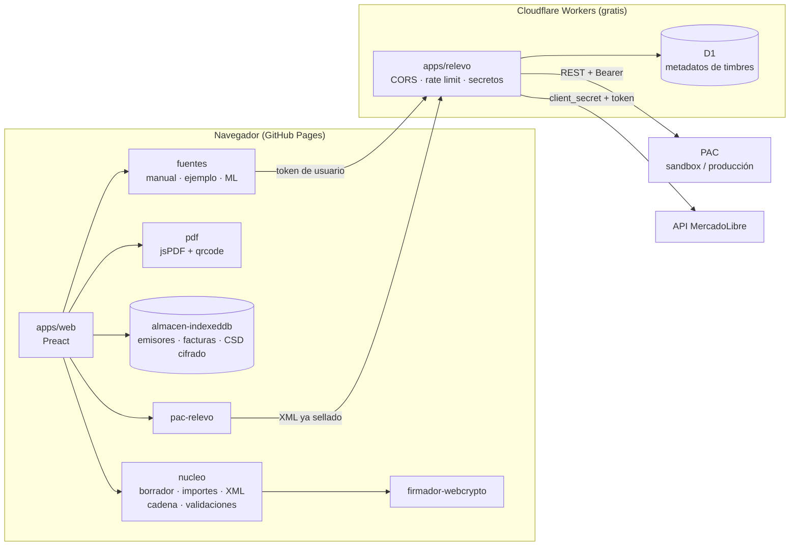
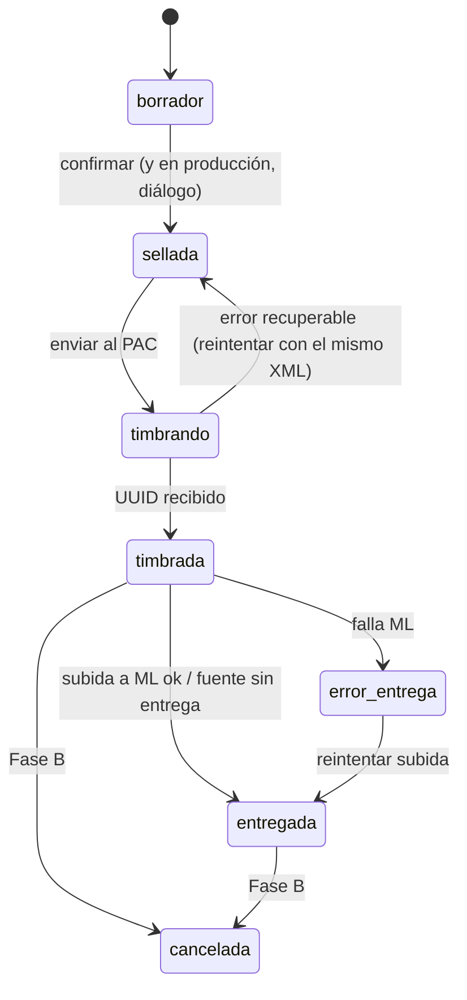
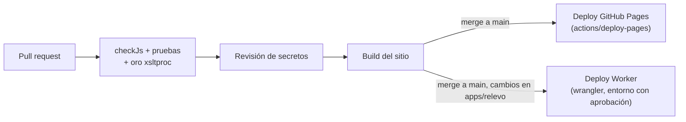

# Documento de diseño: plataforma de facturación low cost

Fecha: 2026-10-23. Estado: **borrador para aprobación**.
Requisitos: [requirements.md](requirements.md). Pantallas:
[mockups/index.html](mockups/index.html).

Lo marcado **(verificar)** salió de la investigación pero no se pudo confirmar
contra la fuente oficial.

## Resumen

Un **sitio estático** (GitHub Pages) hace todo el trabajo de facturación en el
navegador: arma el borrador, genera el XML CFDI 4.0, calcula la cadena
original, sella con el CSD, genera el PDF y guarda las facturas en el
dispositivo. Un **relevo** en Cloudflare Workers (capa gratuita) hace solo lo
que un navegador no puede: hablar con el PAC y con MercadoLibre, que no
aceptan llamadas directas desde el navegador (no hay CORS) y exigen secretos de
aplicación.

El código se organiza como la plataforma futura desde el inicio: un **núcleo**
puro e independiente del entorno, **adaptadores** detrás de interfaces
(fuente de ventas, PAC, almacén, firmador) y **apps** delgadas (web y relevo)
que solo conectan piezas. Pasar a la Fase C es agregar adaptadores (almacén en
servidor, cuentas), no reescribir el núcleo.

### Decisiones principales

| # | Decisión | Por qué | Alternativa descartada |
|---|---|---|---|
| D1 | Sellado en el navegador; el CSD nunca sale del equipo | Costo $0 y argumento de confianza para la plataforma | Sellar en servidor: exige custodiar CSD de terceros |
| D2 | Relevo en **Cloudflare Workers** | 100 000 peticiones/día gratis, secretos cifrados, D1 y rate limiting; no prohíbe uso comercial en el plan gratis | Vercel Hobby prohíbe uso comercial; Deno Deploy se describe como uso personal |
| D3 | **GitHub Pages** para la Fase A, desplegado con Actions | Lo pidió el usuario; gratis con repo público | — La Fase C se muda (los términos de Pages no permiten SaaS comercial) |
| D4 | JavaScript ESM con tipos **JSDoc** revisados por `tsc --checkJs` | El núcleo corre en Node sin compilar (pruebas con `node:test`) y aun así tiene tipos | TypeScript compilado: agrega un paso de build al núcleo |
| D5 | Interfaz con **Preact + Vite** | Preact pesa ~4 KB; Vite da build estático y `base` configurable para moverse de hosting | React (más pesado); vanilla (frágil al crecer) |
| D6 | **Cadena original generada en código**, validada contra el XSLT oficial del SAT en pruebas | Chrome retira XSLT del navegador (nov-2026); las librerías JS existentes dependen de Saxon u OpenSSL | XSLT en navegador; SaxonJS (licencia propietaria) |
| D7 | `.key` del SAT: **node-forge** solo para descifrarla (PBES2 + 3DES); la firma la hace **WebCrypto** con llave no exportable | WebCrypto no implementa 3DES; después de descifrar, la llave vive como `CryptoKey` que ni el propio código puede leer | Firmar con forge (llave legible en memoria JS) |
| D8 | Primer PAC: **SW Sapien sandbox** (REST, CSD de prueba públicos); PAC de producción se elige en la Fase B | Documentación abierta y RFC de prueba como EKU9003173C9 | Finkok (SOAP; buen precio, candidato para producción) |
| D9 | App de MercadoLibre **propia del facturador**, separada de Catálogo 3D | El refresh_token de ML es de un solo uso: dos apps refrescando el mismo token se rompen entre sí | Compartir `~/.catalogo3d/ml_token.json` como decía el plan local |
| D10 | Monorepo con **npm workspaces** | Separa núcleo, adaptadores y apps sin herramientas extra | Repos separados (más fricción) |

## Arquitectura



Qué cruza la red y qué no:

| Dato | ¿Sale del navegador? |
|---|---|
| `.key`, contraseña del CSD, llave descifrada | **Nunca** |
| XML sellado | Sí, al relevo y de ahí al PAC (no se guarda) |
| Token de usuario de ML | Sí, por petición, al relevo (no se guarda) |
| Credenciales del PAC, `client_secret` de ML | Solo existen en el relevo (secretos de Cloudflare) |
| Metadatos de timbre (emisor, ambiente, fecha, resultado) | Se guardan en D1, sin contenido de la factura |

### Estructura del repositorio

```
packages/
  nucleo/          puro: sin DOM, sin fs, sin fetch. Corre en navegador, Node y Worker
    importes.js      total ML → unitario (6 dec), subtotal, IVA, cuadre al centavo
    borrador.js      venta normalizada + emisor → borrador validado
    receptor.js      normaliza RFC/razón social, régimen ↔ uso CFDI
    xml.js           borrador → XML CFDI 4.0 (sin sello)
    cadena.js        XML → cadena original 4.0 (subconjunto soportado)
    sellar.js        orquesta: cadena → firmador.firmar() → XML sellado
    qr.js            URL de verificación del SAT
    catalogos/       subconjunto de catálogos SAT en JSON (régimen, uso, forma de pago…)
    errores.js       códigos propios + traducción de errores de PAC y ML
    puertos.js       definiciones JSDoc de las interfaces
  firmador-webcrypto/  abrir .cer/.key (forge) → CryptoKey no exportable → firmar
  firmador-node/       mismo contrato con node:crypto (pruebas y servidor futuro)
  pdf/                 representación impresa con QR
  fuentes/             manual · ejemplo · mercadolibre
  pac/                 relevo (cliente) · sw-sapien (lo usa el relevo)
  almacen/             indexeddb · memoria (pruebas)
apps/
  web/             Vite + Preact; pantallas de los mockups
  relevo/          Cloudflare Worker
fixtures/
  csd-prueba/      CSD públicos de prueba (EKU9003173C9), con hash en lista blanca
  ventas/          las dos ventas de referencia, con RFC de prueba
docs/
```

La carpeta `src/` actual se reemplaza por `packages/` y `apps/`. Sus README se
mueven al módulo equivalente.

## Componentes e interfaces

Las interfaces (puertos) viven en `packages/nucleo/puertos.js` como tipos
JSDoc. Todo adaptador las cumple y tiene un doble en memoria para pruebas.

```js
/** Fuente de ventas: MercadoLibre, captura manual, ejemplo, (futuro) Shopify… */
// buscar(idVenta) → Promise<Venta>
// listarPendientes({ desde }) → Promise<Venta[]>
// entregar(idVenta, { xml, pdf }) → Promise<Entrega>   // opcional; ML sí, manual no
// facturaExistente(idVenta) → Promise<boolean>

/** Firmador: el núcleo nunca ve la llave */
// certificado() → { noCertificado, certificadoB64, rfc, vigenciaHasta }
// firmar(cadenaOriginal: string) → Promise<string /* base64 */>

/** PAC */
// timbrar(xmlSellado, { ambiente, emisorId, idempotencia }) → Promise<{ xmlTimbrado, uuid }>
// cancelar(uuid, motivo, …) → Promise<…>        // Fase B

/** Almacén */
// emisores.{listar, obtener, guardar}
// facturas.{listar, obtener, guardar, porEstado}
// csd.{guardar, obtener, borrar}               // guarda la .key tal cual (ya viene cifrada por el SAT)
// folios.siguiente(emisorId, serie) → número    // atómico por transacción
// contadores.sumar(emisorId, ambiente, mes)
```

### Núcleo (`packages/nucleo`)

- **Importes.** Por concepto: `unitario = redondear6(totalML / 1.16 / cantidad)`,
  `importe = redondear2(unitario × cantidad)`, `iva = redondear2(importe × 0.16)`.
  Se suma y se compara con el total de ML. Si hay diferencia de un centavo con
  varios conceptos, se ajusta el unitario del concepto de mayor importe dentro
  de la tolerancia del SAT; si no se puede cuadrar, error `IMPORTE_NO_CUADRA`
  (Req. 4.3). Se trabaja en **centavos enteros y millonésimas enteras** (sin
  `float`) para que el resultado sea idéntico en todos los entornos.
- **Receptor.** Recorta, pasa a mayúsculas, quita régimen capital
  (`S.A. DE C.V.`, `S. DE R.L.`, …), valida el patrón de RFC y la matriz
  régimen ↔ uso CFDI del catálogo del SAT. `XAXX010101000` produce el aviso
  `PUBLICO_EN_GENERAL` (Req. 3.4).
- **XML.** Se construye con funciones propias de serialización (escape XML y
  orden fijo de atributos). El subconjunto soportado en la Fase A: Comprobante
  tipo I, Emisor, Receptor, Conceptos con traslado de IVA, Impuestos. Lo que
  no está en el subconjunto se rechaza con un error claro en vez de generarse
  mal.
- **Cadena original.** Implementación de las reglas de
  `cadenaoriginal_4_0.xslt` para ese mismo subconjunto. La prueba de oro la
  compara contra `xsltproc` con el XSLT oficial (D6).
- **QR.** `https://verificacfdi.facturaelectronica.sat.gob.mx/default.aspx?id={UUID}&re={RFC}&rr={RFC}&tt={total}&fe={últimos 8 del sello}`
  (formato de `tt` y escape de RFC según el Anexo 20; verificar).

### Firmador en navegador (`packages/firmador-webcrypto`)

1. Lee `.cer` con forge, obtiene número de serie → `NoCertificado` (hex →
   ASCII), RFC del sujeto y vigencia. Bloquea si no coincide con el emisor o
   está vencido (Req. 2.5).
2. Descifra la `.key` (PKCS#8 cifrado, PBES2 + PBKDF2 + 3DES; confirmado con la
   llave de prueba) con la contraseña. Contraseña incorrecta → `CSD_CONTRASENA`.
3. Importa el PKCS#8 en claro con `crypto.subtle.importKey('pkcs8', …,
   { name: 'RSASSA-PKCS1-v1_5', hash: 'SHA-256' }, false, ['sign'])` y borra
   los bytes intermedios.
4. La `CryptoKey` vive solo en memoria durante la sesión; al cerrar la pestaña
   o a los 30 min sin uso se descarta.
5. «Recordar en este equipo» guarda la **`.key` original** (ya cifrada por el
   SAT) y el `.cer` en IndexedDB. No se guarda la contraseña (Req. 2.3).

node-forge se carga **solo** en la pantalla de CSD (import dinámico), para no
pesar en el resto de la app (~74 KB gzip).

### Relevo (`apps/relevo`, Cloudflare Worker)

| Ruta | Hace | Guarda |
|---|---|---|
| `POST /pac/timbrar` | Recibe `{ xml, ambiente, emisorId, idempotencia }`, llama al PAC con las credenciales del ambiente, regresa XML timbrado o error normalizado | Una fila de metadatos en D1 |
| `POST /ml/token` | Intercambia `code` + `code_verifier` por tokens agregando `client_secret` (PKCE activado) | Nada |
| `POST /ml/refresh` | Renueva con `refresh_token` + `client_secret` | Nada |
| `GET\|POST /ml/api/*` | Reenvía a `api.mercadolibre.com` solo rutas de una **lista blanca** (`/packs/:id`, `/orders/:id`, `/orders/:id/billing_info`, `/packs/:id/fiscal_documents`, `/orders/search`) | Nada |
| `GET /salud` | Versión y ambiente | Nada |

Reglas del relevo:

- **CORS** solo para el origen configurado del sitio (Req. 8.5).
- **Producción deshabilitada** en la Fase A: el relevo no tiene credenciales
  de producción y responde `AMBIENTE_NO_DISPONIBLE`.
- **Rate limit** con el binding `ratelimits` por IP: 5 timbrados/min en la
  demo. Más un **tope diario** contado en D1, porque el binding es aproximado.
- **Sin registros de contenido**: los logs nunca incluyen XML, RFC ni tokens.
- Validación de tamaño (XML < 100 KB) y de que el XML venga sellado.
- Presupuesto: 10 ms de CPU por petición en el plan gratis. El relevo solo
  reenvía (la espera de red no cuenta como CPU), así que cabe.

### Fuentes de ventas (`packages/fuentes`)

- **ejemplo**: las dos ventas de referencia ($198.00 y $188.10) con el
  receptor de prueba URE180429TM6. Sin red.
- **manual**: formulario → `Venta`.
- **mercadolibre** (Fase B): OAuth con PKCE desde el navegador; tokens en
  IndexedDB; todas las llamadas pasan por `/ml/api/*`. Al renovar, se guarda
  el **nuevo** refresh_token antes de usarlo (es de un solo uso). Duración real
  del access_token: lo que diga `expires_in`.
  `entregar()` sube PDF y XML (máx. 1 MB, PDF obligatorio) a
  `/packs/{id}/fiscal_documents`; un 409 significa que ya existe y se
  reporta como `ML_YA_TIENE_FACTURA`.

### PDF (`packages/pdf`)

jsPDF (~132 KB gzip) + qrcode (~10 KB), cargados con import dinámico al
terminar el timbrado. Incluye emisor, receptor, conceptos, totales, UUID,
sellos, cadena del TFD y QR. En sandbox se imprime la marca de agua «SIN
VALIDEZ · SANDBOX» (Req. 0.5). Si pesa más de 1 MB, se avisa antes de subir
(Req. 7.6).

### App web (`apps/web`)

Pantallas = mockups: Portada, Panel, Nueva factura, Revisar, Confirmar
producción, Factura lista, Emitidas, Emisor y CSD. Estado con señales de
Preact; rutas por hash (`#/emitidas`) para que funcione en cualquier hosting
estático sin reglas de reescritura. La URL base y la del relevo vienen de
`config.<ambiente>.json` en el build (Req. 9.6).

La demo (Req. 0) es la misma app arrancada con la configuración `demo`: emisor
EKU9003173C9 precargado, fuentes `ejemplo` y `manual`, CSD de prueba cargado
automáticamente con su contraseña pública, y producción oculta.

## Modelos de datos

Todos los documentos guardados llevan `esquema` (versión) y `emisorId`
(Req. 9.3, 9.5). Importes como cadenas decimales exactas.

```js
// Emisor
{ esquema: 1, id: "em_01J…", rfc, nombre, regimenFiscal: "625", lugarExpedicion,
  series: { A: { siguiente: 14 } },
  comprobante: { formaPago: "31", metodoPago: "PUE", moneda: "MXN" },
  conceptoPorDefecto: { claveProdServ, claveUnidad: "H87", objetoImp: "02", tasaIva: "0.160000" },
  ambientes: ["sandbox"] }

// Venta (salida normalizada de cualquier fuente)
{ fuente: "mercadolibre", id: "2000009876543210", packId, fecha,
  total: "198.00", conceptos: [{ descripcion, cantidad: 1, total: "198.00", sku }],
  receptor: { rfc, nombre, regimenFiscal, usoCfdi, codigoPostal } | null }

// Factura (registro local, una por intento de timbrado)
{ esquema: 1, id: "fa_01J…", emisorId, ambiente: "sandbox",
  venta: { fuente, id }, serie: "A", folio: 13,
  borrador: { … }, xmlSellado, xmlTimbrado, uuid, pdf: Blob,
  estado: "borrador" | "sellada" | "timbrando" | "timbrada" | "entregada" | "error_entrega" | "cancelada",
  idempotencia: "<sha256 del xml sellado>", eventos: [{ fecha, estado, detalle }] }

// Contador (local y, como metadato, en D1)
{ emisorId, ambiente, mes: "2026-10", timbres: 14 }
```



D1 (relevo), una sola tabla en la Fase A:

```sql
CREATE TABLE timbres (
  id INTEGER PRIMARY KEY, emisor_id TEXT NOT NULL, ambiente TEXT NOT NULL,
  fecha TEXT NOT NULL, resultado TEXT NOT NULL, idempotencia TEXT NOT NULL
);
```

## Manejo de errores

- **Errores tipados** (`{ codigo, mensaje, accion, detalleTecnico }`) en
  `nucleo/errores.js`. La UI muestra `mensaje` y `accion`; `detalleTecnico` va
  en un desplegable (mockup 9).
- **El borrador nunca se pierde**: se guarda en IndexedDB en cada cambio.
- **No timbrar dos veces** (Req. 6.4):
  1. Antes de enviar, la factura se guarda en estado `timbrando` con el XML
     sellado y su hash.
  2. Un reintento reenvía **el mismo** XML sellado (misma fecha, mismo sello),
     no uno nuevo.
  3. El PAC detecta el duplicado y regresa el timbre original (verificar el
     código exacto en SW Sapien; se mapea a éxito).
  4. Al abrir la app, toda factura en `timbrando` se reconcilia reenviando
     igual.
- **Folios**: se reservan con una transacción de IndexedDB al sellar; un folio
  usado en un intento fallido no se reutiliza para otra venta.
- **ML**: `401` → renovar token y repetir una vez; si falla, pedir reconectar
  sin perder el borrador (Req. 3.7). `409` en entrega → `ML_YA_TIENE_FACTURA`.
  `429` → reintento con espera exponencial.
- **Relevo caído / sin red** → `RED_NO_DISPONIBLE` con botón de reintento.
- **Errores del PAC**: tabla de traducción de códigos CFDI40xxx frecuentes a
  español simple; los no mapeados muestran el mensaje original.

## Seguridad

- **CSP por `<meta>`** (GitHub Pages no permite headers): `default-src 'self'`,
  `connect-src` solo al relevo, sin scripts de terceros en tiempo de ejecución
  (todo empaquetado por Vite). Al mudar a otro hosting se agrega CSP por header
  con `frame-ancestors`.
- La documentación de GitHub Pages recomienda no usar Pages para transacciones
  sensibles como contraseñas. Aquí la contraseña del CSD **nunca se transmite**,
  pero es una razón más para mudar el sitio en la Fase B/C.
- Dependencias con versión exacta y `package-lock.json`. Evitar versiones con
  menos de dos semanas de publicadas.
- Tokens de ML en IndexedDB: su riesgo principal es XSS, mitigado por la CSP y
  por no renderizar HTML externo.

## Estrategia de pruebas

| Nivel | Qué | Con qué |
|---|---|---|
| Unitarias del núcleo | Importes (incluye 198.00 → 170.689655 / 27.31 y 188.10 → 162.155172 / 25.94), receptor, catálogos, XML, QR | `node:test` |
| Oro de cadena original | Cadena generada = salida de `xsltproc` con `cadenaoriginal_4_0.xslt` oficial, para cada fixture | `node:test` + `xsltproc` en CI |
| Sellado | Firma con CSD de prueba en `firmador-node` y `firmador-webcrypto` (WebCrypto de Node) da **el mismo sello**; la firma verifica con el `.cer` | `node:test` |
| Adaptadores | ML y PAC con `fetch` simulado y respuestas grabadas (sin datos reales) | `node:test` |
| Relevo | CORS, lista blanca, rate limit, que nunca se registre el XML | `wrangler dev` / Miniflare |
| Contra sandbox | Timbrar los dos fixtures en el sandbox de SW (manual o nocturno, no en cada PR) | script `npm run sandbox` |
| Interfaz | Flujo de la demo de principio a fin | Playwright (se justificará al agregarlo; puede esperar) |

## Integración y despliegue (CI/CD)



- **Revisión de secretos** (Req. 8.4): script propio que falla si encuentra
  `.cer`, `.key`, `.pfx` o RFC con patrón real fuera de la lista blanca de
  fixtures (por hash SHA-256 y por RFC de prueba conocido), más `gitleaks`.
- **Pages**: `configure-pages` → `upload-pages-artifact` → `deploy-pages`
  con permisos `pages: write`, `id-token: write`.
- **Relevo**: `wrangler deploy` con `CLOUDFLARE_API_TOKEN` en un *environment*
  de GitHub que requiere aprobación manual. Secretos del PAC y de ML con
  `wrangler secret put`, nunca en el repo.
- **Mudanza** (Req. 9.6): cambiar de hosting es cambiar el job de deploy y
  `config.<ambiente>.json`; el build es el mismo.

## Dependencias nuevas (se documentan en `docs/02-arquitectura.md`)

| Paquete | Dónde | Por qué |
|---|---|---|
| `preact` | web | UI ligera (D5) |
| `vite` (dev) | web | build estático portable |
| `node-forge` | firmador-webcrypto | descifrar la `.key` del SAT (3DES) (D7) |
| `jspdf`, `qrcode` | pdf | PDF y QR en el navegador |
| `typescript` (dev) | raíz | `tsc --checkJs` sobre JSDoc (D4) |
| `wrangler` (dev) | relevo | desarrollo y despliegue del Worker |

Se eliminan del plan anterior `fastify`, `pdfkit` y `xmlbuilder2`.

## Lo que este diseño cambia en la documentación existente

- `docs/02-arquitectura.md` y `README.md`: de app local con fastify a sitio
  estático + relevo; `~/.facturador/` deja de ser el lugar de los secretos
  (pasan a IndexedDB del usuario y a secretos de Cloudflare).
- `CLAUDE.md`: aclarar que los **CSD públicos de prueba** sí pueden estar en
  `fixtures/` (con lista blanca), y que la regla de secretos aplica a CSD
  reales.

## Preguntas abiertas

1. ¿Aceptas guardar los CSD públicos de prueba en `fixtures/` (cambia la regla
   de `CLAUDE.md`)?
2. ¿Te parece bien registrar una app nueva de MercadoLibre solo para el
   facturador (D9)?
3. ¿Nombre de la marca? En los mockups usé «Facturalow» de forma provisional.
4. Se necesita una cuenta gratuita de Cloudflare y otra del sandbox de SW
   Sapien. Las abres tú; yo no creo cuentas.
